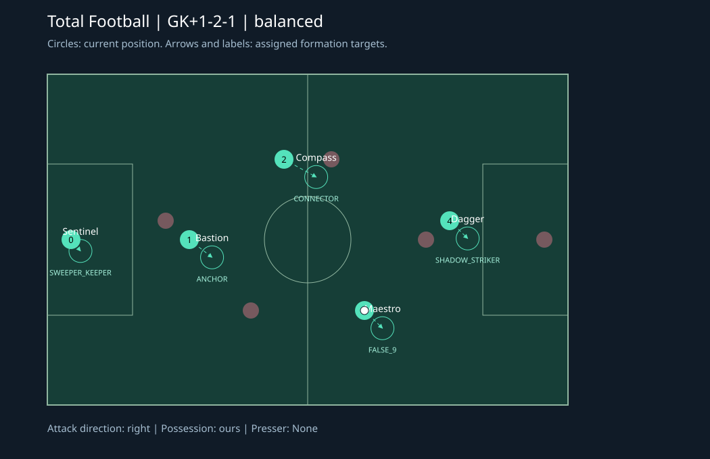

# Total Football team

Five independent Strands agents with recognizable identities, shared tactical
reasoning inputs, fluid outfield roles, and bounded inference latency. This is a
new team; the supplied balanced, aggressive, defensive, memory and gateway teams are unchanged.

## Players and responsibilities

Names and starting biases persist. Each invocation explicitly tells the player
its **current role**, its duty, all teammates' roles and destinations, and the
intended shape after gaining or losing possession. Responsibilities can rotate
between outfield players; they are never inferred solely from a fixed shirt number.

| Player | Identity | Starting bias | Main responsibility |
| --- | --- | --- | --- |
| 0 | Sentinel | Sweeper keeper | Protect goal, anticipate shots, start safe distribution |
| 1 | Bastion | Anchor | Protect the counterattack lane and recycle possession |
| 2 | Compass | Connector | Create passing triangles, provide width, cover the anchor |
| 3 | Maestro | False nine | Drop between lines and release the striker |
| 4 | Dagger | Shadow striker | Stretch defenders, run channels, attack cutbacks |

## Formation setups

`GK+` separates the keeper from the four outfield players. Coordinates mirror for
the away team. Targets shift slightly with the ball while preserving width.

| Situation | Shape | Attack-relative outfield x targets before ball shift |
| --- | --- | --- |
| Balanced, our possession | GK+1-2-1 | -22, 0, 14, 32 |
| Balanced, defending or uncertain possession | GK+2-1-1 | -28, -12, -4, 18 |
| Leading in final 1/9 of match | GK+3-1 | -34, -22, -10, 12 |
| Trailing in final 1/6 of match | GK+1-1-2 | -14, 10, 25, 38 |
| Kickoff/free-kick restart | GK+1-2-1 restart | -28, -12, -7, -1 |



The diagram is generated from a demonstration snapshot, not a match result.
Inspect any real game payload or regenerate the diagram:

```powershell
python inspect_team.py
python inspect_team.py --state payload.json --team 1 --svg away-formation.svg
python inspect_team.py --benchmark 1000
```

The inspector accepts a raw state, an invocation object, or a `prompt` wrapper.
Its output lists every player's live role, duty, target, and fallback command.

## How coordination works

`../lib/total_football/tactics.py` calculates the same plan independently in each
runtime from the same snapshot. It searches at most 24 outfield assignments,
minimizing movement, workload for tired players, and unnecessary changes from
position bias. Different snapshots can produce different plans; there is no
claim of synchronized shared memory across AgentCore runtimes.

Exactly one player is designated to close down or collect the ball. Within a
one-unit distance tie, the player with more stamina wins; shirt number breaks
remaining ties. Others maintain formation. The keeper collects only loose balls
inside its defensive area. The anchor protects rest defense. Sprinting below
30% is blocked except in an emergency near our goal, and pressing intensity
reduces below 35%. The engine owns stamina depletion and regeneration.

Pass options consider the passing lane, projected opponent movement, receiver
space, forward progress and distance. Finishing uses Euclidean range, angle,
pressure and lane obstruction. The shot score is a **heuristic**, not a measured
goal probability. The model still makes the normal action decision; procedural
calculations provide context, enforce protocol, and supply a fallback.

Up to 300 opponent observations per identified match/team are retained in local
memory; only the last three enter the prompt. The store holds at most 16 matches,
deduplicates ticks, ignores late observations, and never mixes anonymous games.
Use a unique `matchId` for each match. AgentCore `context.session_id` is used only
when no match ID is provided. Memory is best effort and disappears on restart.
The latest three coach messages are also included for model interpretation.

## Important input details

* **Possession IDs can collide between teams.** Include
  `ball.possessionTeamId: 0|1` or `ball.possessionTeamCode: "home"|"away"` when
  both teams use `agentId_0` through `agentId_4`. Globally unambiguous holder indices
  also resolve. If the payload contains only a colliding ID, ownership is
  unknowable: agents approach and cover rather than inventing passes/shots.
  Confirm the tournament feed supplies this discriminator before competitive use.
* **Stamina documentation conflicts with existing fixtures.** Percent and
  fraction snapshots are both supported. If any stamina exceeds 1, the snapshot
  is treated as percent; otherwise fraction. Explicit `gameState.staminaScale`
  (`"percent"` or `"fraction"`) resolves the all-players-at-0..1-percent ambiguity.
* **Match duration is unspecified.** `gameTime` is treated as elapsed seconds.
  Supply `gameState.matchDuration` in seconds or configure
  `FOOTBALL_MATCH_SECONDS`; the default is 5400. Compressed matches need their
  real duration to trigger late-game formation changes correctly.

## Latency and failure behavior

The request budget defaults to **700 ms**. A model call exceeding the remaining
budget yields the current snapshot's role-aware fallback. At most one model call
can be in flight per runtime, so timeouts cannot build an unbounded worker queue.
Late output is discarded; ticks arriving while the worker drains use their own
fresh fallback. Each model call gets a new conversation, avoiding growing history
and contamination between simultaneous matches. No MCP or agent-to-agent network
calls are used in the decision path.

The model defaults to `us.amazon.nova-micro-v1:0`, temperature 0.1 and 160 output
tokens. SDK transport retries are disabled. Model construction is lazy, so local
inspection and tests need no AWS dependencies or credentials. Configuration uses
the documented [Strands Bedrock model options](https://strandsagents.com/docs/api/python/strands.models.bedrock/).

| Environment variable | Default | Purpose |
| --- | --- | --- |
| `FOOTBALL_MODEL_ID` | `us.amazon.nova-micro-v1:0` | Bedrock inference model |
| `FOOTBALL_DECISION_SECONDS` | `0.7` | Request inference budget; clamped to 0.02..4.0 seconds |
| `FOOTBALL_MATCH_SECONDS` | `5400` | Default match duration when absent from state |
| `AWS_REGION` / `AWS_DEFAULT_REGION` | SDK default | Bedrock region |

Set these variables in the deployed runtime environment as well as locally.
The deadline is a request budget, not a promise that Bedrock responds in 700 ms.
Cold starts, runtime scheduling and network service time require live measurement.
Tune using CloudWatch `football_decision` records: player, live role, mode, source,
latency. `football_latency_violation` flags responses over 850 ms. Compare the
LLM/fallback ratio before increasing the budget; the game guide's maximum is 5 s.

Model commands are validated against actual possession, teammate/opponent
targets, finite coordinates, supported enums, keeper-only actions, stamina and
press ownership. Every response has one command for the effective `myPlayers`
index and explicit team. Invalid output gets a fallback. Maintained commands
expire after one tick. Team-wide RESET and speculative slide tackles are excluded.
If the request omits authoritative team/player identity, the runtime returns an
empty list and logs the problem instead of issuing a command to a guessed side.

## Validate and deploy

Run from this directory with Python 3.10+ (no third-party packages needed):

```powershell
python -m unittest discover -s tests -v
python inspect_team.py --benchmark 1000
```

Tests cover role uniqueness and spatial rotation, fatigue rotation, both team
orientations, old/new payloads, uncertain possession, restart spacing, adaptive
formations, pass lanes, finishing, stamina gates, malformed commands, deadlines,
late output, worker bounds, memory isolation, and randomized fallback invariants.
The benchmark includes a full plan, five contexts, and five validated fallbacks;
it excludes Bedrock, AgentCore transport and cold starts.

For AWS deployment, install the prerequisites documented by the supplied teams:
AgentCore CLI **0.25.0+**, AWS CLI, Node.js, npm, CDK and uv; configure credentials
and enable Bedrock model access. Each agent's `pyproject.toml` declares its runtime
dependencies. The existing CDK scaffold is reused under a distinct project name,
`TeamTotalFootball`, with empty deployment targets until configured.

```powershell
$env:AWS_DEFAULT_REGION = "us-east-1"
python deploy_all.py
```

Deployment packages shared `lib/` source for all five agents, builds CDK, resolves
the AWS account, bootstraps CDK, and deploys the team. It can incur AWS charges.
Only injected source copies are cleaned up. Existing `ai-*/lib` directories are
refused, so they cannot be accidentally overwritten. `python deploy_all.py
--prepare-only` leaves local source copies available for inspection; remove those
copies before a later deployment.

No cloud deployment or paid inference is part of the local validation. Tests and
benchmarks establish protocol and latency behavior locally; tournament strength
needs actual matches against the supplied baseline teams. Track win rate, goal
difference, possession losses, conceded counterattacks, LLM/fallback ratio and
response latency on **both** sides before choosing tournament settings.
